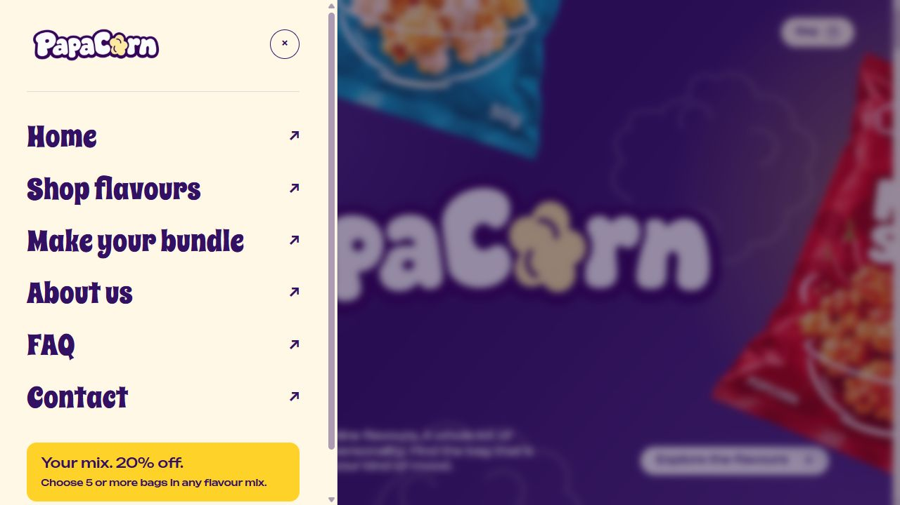

# PapaCorn — Shopify storefront portfolio

A popcorn brand and storefront project with playful packaging, nine flavours, scroll-driven product choreography and custom Shopify pages.

## What the project includes

- Original PapaCorn logo, packaging artwork and lifestyle imagery.
- Pointer-following packets that transition from the homepage banner into a flavour carousel and product details.
- Scroll-linked heading fills, a photo strip and three snack-story chapters, with reduced-motion fallbacks.
- A left flyout menu, six configurable homepage FAQs and branded navigation and footer components.
- Shopify product, catalog, cart, About, Contact and Make Your Bundle sections.
- A bundle builder for any flavour mix, with a 20% savings preview at five or more bags and native Shopify cart integration.

All nine flavours are 50g bags at PKR 150: Sweet & Salted, Cheese, Hot & Spicy, Choc Corn, Butter Scotch, Caramel Peanut, Plain, Toffee and BBQ.

## Repository layout

| Directory | Contents |
| --- | --- |
| `docs/` | Standalone HTML/CSS/JavaScript homepage design demo and its local artwork |
| `theme/` | Original PapaCorn Shopify components, assets, translations and templates |
| `screenshots/` | Storefront screenshots captured during design review |

The standalone demo has an earlier navigation and FAQ arrangement than the current native Shopify components. Its bag uses local in-memory sample data; its checkout does not place orders. The native bundle builder, product data and checkout run in Shopify.

## Preview the design demo

Serve `docs/` with any static HTTP server, then open its `index.html`. For a GitHub Pages demo, select your publishing branch and the `/docs` folder in the repository's Pages settings. No JavaScript package installation is required.

## Shopify source

The `theme/` directory is a component package, not a complete theme. It contains PapaCorn's original files and requires a compatible Shopify theme and store to render its native pages. See [the component guide](theme/README.md).

The storefront was integrated with Shopify's Horizon theme. Horizon's base source, layout, configuration and third-party locale strings are excluded from this public repository because its current licence restricts off-platform redistribution of derived themes. The original custom components can be reviewed independently here. See [Horizon licensing](https://github.com/Shopify/horizon/blob/main/LICENSE.md).

This portfolio repository is not connected to a Shopify theme; committing here does not update the live store.

## Validation and assets

The Shopify implementation passed 76 regression checks and 33 integrated theme-file checks before publication. The standalone demo's JavaScript syntax and relative asset dependencies were checked while preparing this repository. Screenshots document the review state and may show draft-product preview labels.

The Bounded and Spicy Rice fonts retain their SIL Open Font License notices. Original packaging and campaign imagery were created for the PapaCorn project; campaign scenes are illustrative. See [licence and attribution notes](NOTICE.md).
